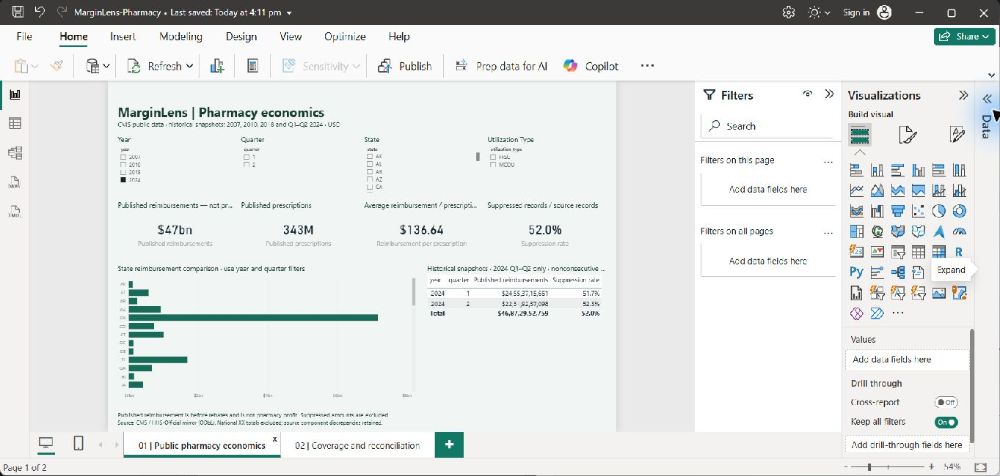

# MarginLens

**Retail margin and contract intelligence.** A reproducible, deployable analytics portfolio project using synthetic data.

[Open the deployed app](https://marginlens-retail-finance.swoonysnipe19.chatgpt.site) · [Verified CI run](https://github.com/Ashik-Mohammed-S/Marginlens/actions/runs/41355087992) · [Release record](reports/RELEASE.md)

The hosted web dashboard is public. Use Client briefing in its navigation for the presentation.

## Power BI dashboard preview



Actual Power BI Desktop screenshot, captured 4 November 2026. The native report has pharmacy economics and coverage/reconciliation pages, with year, quarter, state and utilization-type filters. Its aggregate model was derived from 11,960,653 accepted public Medicaid state records. The selected 2024 snapshot covers Q1–Q2 only; reimbursements are before rebates and are not pharmacy profit.

This is a **static preview**, not an embedded Power BI Service report. The finished PBIX is delivered locally; online Power BI publication and scheduled cloud refresh remain pending. The public web app above is the separate synthetic retail demonstration.

## What it does

- Performance dashboard with month, region, and category filters.
- Reconciled price-volume-mix-cost margin bridge, with returns separated.
- Searchable, paginated contract exception queue and CSV exports.
- Seasonal baseline versus weekday-trend forecast, chronological validation, independent holdout, and empirical uncertainty.
- Margin scenario calculator with explicit assumptions.
- Data trust view with reconciliation, quarantine, missing costs, contract coverage, and fingerprint.
- Six-slide printable client briefing inside the application.

The synthetic dataset contains 37,060 accepted lines across six fictional stores and nine products, January 2025–October 2026. No employer or patient data is used. Potential shortfall is not recovered revenue. Forecast results on synthetic data do not demonstrate real-world generalization.

## Run locally

Requires Python 3.12+; Node 22+ for dashboard tests. From the repository root:

```sh
python src/pipeline.py
python -m unittest discover -s tests -v
node tests/dashboard.test.cjs
python src/check_release.py
python -m http.server 8765 --bind 127.0.0.1 --directory site/dist
```

Open http://127.0.0.1:8765. The reference build uses only the Python standard library. The snapshot is generated locally and included in the hosted deployment; Git stores its reproducible source and validation fingerprint.

## Independent dbt / DuckDB pipeline

Create and activate a virtual environment, then:

```sh
python -m pip install -r requirements-lock.txt
python src/pipeline.py
python src/run_dbt.py
```

Five SQL models and 11 dbt tests validate the independent transformation against the Python reference. requirements.txt specifies direct dependencies; requirements-lock.txt records resolved audited versions. Re-audit when dependencies change.

## Review order

1. [Business and KPI contract](docs/01-business-contract.md)
2. [Architecture and design decisions](docs/02-architecture.md)
3. [Data dictionary and seeded defects](docs/03-data-dictionary.md)
4. [Forecast and margin methodology](docs/04-methodology.md)
5. [Security and operations](docs/05-security-and-operations.md)
6. [Client demo script](docs/06-client-demo.md)
7. [Validation evidence](reports/VALIDATION.md)

## Project structure

| Path | Purpose |
|---|---|
| src/ | Generation, reference transformation, forecasts, release checks |
| sql/ | Daily financial aggregation |
| dbt/ | Independent DuckDB models and tests |
| tests/ | Financial and dashboard regression tests |
| site/dist/ | Deployable app and data snapshot |
| data/ | Generated CSVs/databases; ignored by Git |
| reports/ | Validation and dependency audit evidence |
| powerbi/ | DAX, theme, import guide; not a finished PBIX |
| docs/ | Business, technical, operational, and presentation documentation |

## Boundaries

This is a complete portfolio demonstration, not a production retailer integration. The static app has no live feed, scheduled refresh, data uploads, backend writes, regional authorization, or incident alert delivery. The hosted demo is public; filters do not enforce data access. Power BI Service and native PBIX execution are not part of the web deployment. See the client adoption gate before connecting confidential data.

GitHub tracks only implementation, validation, and deployment. [Project progress](PROGRESS.md).
